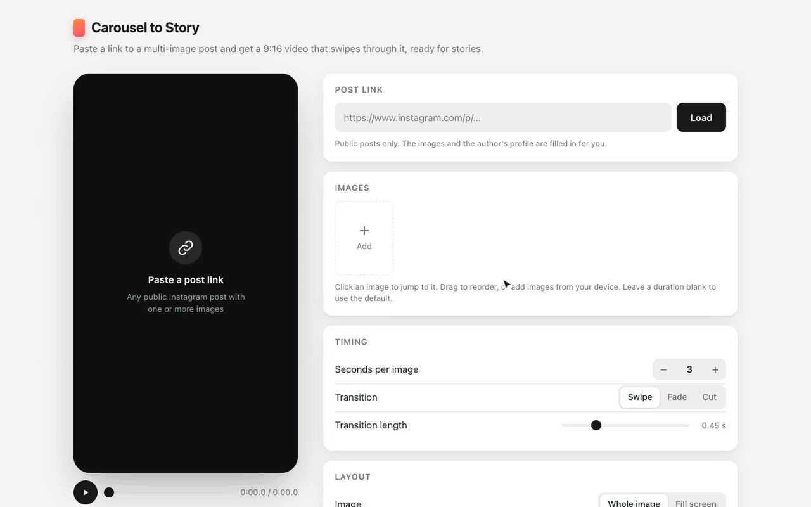

# Carousel to Story

Paste a link to a multi-image Instagram post and get a 9:16 video for Stories. The video swipes through the images like the carousel does, with a credit to the original author.

**Demo:** https://carousel-to-story.insta-post-to-video.workers.dev



<sub>The recording uses sample images. [Watch it in full quality (MP4)](docs/demo.mp4).</sub>

> [!NOTE]
> Instagram often rate-limits requests that come from the demo's server, which runs on shared Cloudflare IPs. In testing, roughly half of the post links failed to load there. If a link fails, try again in a few minutes, or add the images from your device. Everything else works normally.
>
> **Running the app locally works much better.** Requests then leave from your own connection, and every post loaded in testing. See [Development](#development).

## How it works

1. You paste a post link, such as `https://www.instagram.com/p/…`.
2. A tiny API (`/api/post`) reads the public post page and returns the image URLs, the author's username and their profile picture.
3. The browser downloads the images straight from Instagram's CDN, renders every frame on a canvas, and encodes an MP4 with WebCodecs. The video is never uploaded anywhere.

You can open the app with a post already loaded: `https://your-app/?url=https://www.instagram.com/p/…`.

## Features

- **1080×1920, 30 fps H.264 MP4**, the format Stories expect. A 30 s video renders in a few seconds.
- **Credits filled in automatically** from the post's author (@handle and profile picture). You can edit or remove them. Six positions are available, styled as a pill or plain text.
- **Timing**: a default duration per image (3 s), with an optional override for each image.
- **Transitions**: swipe (like the carousel itself), fade or cut, with adjustable length.
- **Layout**: show the whole image on a blurred or solid-color background, or fill the screen. Rounded corners and carousel dots are optional.
- **Safe zones**: content stays clear of the areas the Stories UI covers. You can toggle an overlay to check.
- Images can also be added from the device, by dropping, pasting or picking them. Reorder by drag or with the arrow buttons.
- On phones, **Share…** sends the video straight to the Instagram app.

## Limitations

- Only **public** posts work. Private, age-restricted and some region-locked posts can't be read without logging in. For those, add the images manually.
- Videos inside a carousel appear as their cover image.
- The API reads the same server-rendered page that Instagram serves to search engines. Instagram can change or restrict that page at any time. If loading breaks, `server/instagram.ts` is the single place to fix.
- Instagram rate-limits many datacenter IPs, so a hosted API fails more often than a local one (see the note at the top). Hosting the API somewhere with different outgoing IPs may help, but this hasn't been tested yet.

## Development

```sh
npm install
npm run dev      # app + API on http://localhost:5173
npm run build    # type-check + production build into dist/
```

The project uses Vite and TypeScript, with no UI framework. The only runtime dependency is [Mediabunny](https://mediabunny.dev), the MP4 muxer, and it is loaded only when you export.

| File | Role |
| --- | --- |
| `server/instagram.ts` | Post link → images + author. Uses only the Fetch API, so it runs in Node (dev) and on Cloudflare Workers |
| `worker/index.ts` | Cloudflare Worker entry: `/api/*` goes to the handler, everything else to static assets |
| `src/scene.ts` | Layout and the pure `drawFrame(ctx, scene, t)` renderer, shared by the preview and the export |
| `src/export.ts` | Frame-by-frame render and encode to MP4 |
| `src/media.ts` | Image decoding, the cross-browser blurred backdrop, and the avatar crop |
| `src/settings.ts` | Settings, defaults, validation and persistence |
| `src/main.ts` | UI wiring |

The preview and the export call the same renderer, so the downloaded video matches the preview frame for frame. Every static element (cards with their shadows, backdrops, the credit badge) is pre-rendered once, so each frame needs only a few `drawImage` calls.

## Deploying

The site and the API deploy together as one Cloudflare Worker. The free plan is enough.

```sh
npm run deploy   # build + wrangler deploy
```

The first run asks you to log in to Cloudflare. Configuration lives in `wrangler.jsonc`.

## Browser support

The app needs WebCodecs H.264 encoding. That means recent Chrome, Edge or Safari (16.4+), or Firefox 130+ on desktop.

## License

MIT
